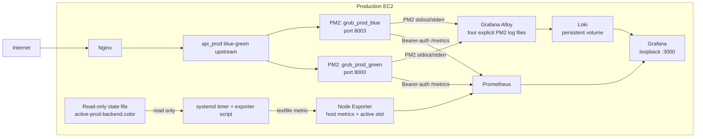

# Architecture

## Data flow and boundaries

- Backend instances remain native Bun/PM2 processes. Their configured listen ports are unchanged.
- Prometheus reaches the host through Docker's `host-gateway` mapping and scrapes Green `:8000` and Blue `:8003` independently, including the standby.
- `/metrics` requires the shared bearer secret. Store the app copy in the existing production environment file and mount the matching secret file into Prometheus.
- The active-slot helper reads `/var/lib/grubadmin/active-prod-backend.color`, validates `blue` or `green`, and atomically writes a Node Exporter textfile metric. It never writes to the blue-green state file.
- Alloy mounts only the specified PM2 output/error files, read-only. Static labels identify service, environment, slot, log type, and host. Persistent Alloy positions prevent rereading already tailed content after restart.
- Loki and Prometheus data, Grafana state, and Alloy positions use named Docker volumes. Prometheus, Loki, Alloy, and Node Exporter have no published ports; Grafana is published only on host loopback.
- Grafana is the only dashboard surface. Use SSH port forwarding; no Nginx or security-group change is required.

## Availability meaning

Prometheus `up` indicates a successful metrics scrape, not a synthetic API readiness check. The configured metrics target is served by the application process. Keep `/api/v1/common/readyz` checks in the existing deployment and external health checks for dependency readiness; this monitoring stack does not change that deployment path.
